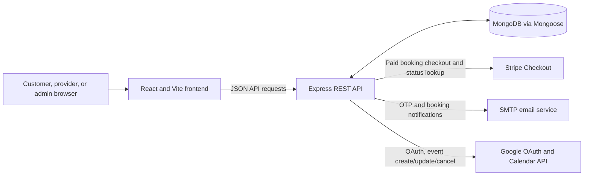

# BookHop

BookHop is an appointment-booking application for independent service businesses. Providers can describe their services, define weekly availability, and share a public booking page; customers can select an appointment and verify their email. The application also includes provider booking and payout workflows and a separate platform-admin console.

## The problem BookHop addresses

Independent providers often coordinate appointments, availability, and customer details manually. BookHop brings those tasks into a small web workspace: providers maintain offerings and bookable hours, and customers can request a time through a business-specific link. Paid appointments can be handed off to Stripe Checkout; optional email and Google Calendar integrations support notifications and event management.

## Features

### Business providers

- Register with a one-time email verification code and sign in.
- Configure a business name, description, timezone, and brand appearance.
- Create, activate, hide, and remove services with durations, prices, descriptions, and icons.
- Set weekly time windows; the available-slot generator excludes confirmed bookings and recent pending-payment holds.
- Share a public booking page at `/<business-slug>`.
- Review, filter, cancel, and reschedule bookings. Cancellation does not automatically refund a paid customer.
- View wallet and withdrawal information, save bank/UPI payout details, and request a withdrawal.
- Optionally connect Google Calendar for booking event creation, updates, and cancellation.

### Customers

- View an active service provider's public page and available appointment slots.
- Verify an email address before submitting a booking.
- Book a free appointment directly, or continue to Stripe Checkout for a paid service when Stripe is configured.
- View the booking result and, when available, open a Google Calendar event link.

### Platform administrators

- Sign in through a separate admin login.
- View platform-level booking, business, revenue, and payout summaries.
- Review recent businesses, paid bookings, and withdrawal requests.
- Change withdrawal status. The actual bank or UPI transfer is handled separately; the dashboard explicitly asks the administrator to process it outside BookHop.

## Technology stack

| Area | Implemented technologies |
| --- | --- |
| Frontend | React 19, React DOM, React Router 7, Vite 8, Axios, Tailwind CSS 4 with its Vite plugin, Lucide React |
| Backend | Node.js (ES modules), Express 5, Nodemon |
| Database | MongoDB through Mongoose |
| Authentication | `jsonwebtoken` and `bcryptjs`; bearer tokens are used by the frontend |
| Payments | Stripe Checkout via the Stripe Node SDK |
| Email | Nodemailer using an SMTP transport |
| Calendar | Google OAuth 2.0 and Google Calendar API via `googleapis` |
| Frontend checks | ESLint with React Hooks and React Refresh plugins |

The repository does not declare a Node.js engine version. Use a Node.js release compatible with the dependency versions installed in each package.

## Architecture

The React SPA communicates with the Express API over HTTP. The API uses MongoDB for application data and calls external providers only for the integrations present in the code: Stripe Checkout, SMTP email, and Google Calendar.



The payment status flow is implemented by creating a Stripe Checkout session and retrieving that session when the customer returns to the booking status endpoint. No Stripe webhook route is present in the application.

## Repository layout

```text
.
├── README.md
├── backend/
│   ├── README.md
│   ├── config/              # MongoDB connection
│   ├── controllers/         # Route handlers and business workflows
│   ├── middleware/          # User and admin JWT guards
│   ├── models/              # Mongoose schemas
│   ├── routes/              # Express route groups
│   ├── utils/                # Email, calendar, payment, time, and wallet helpers
│   ├── package.json
│   ├── server.js
│   └── .env.example
└── frontend/
    ├── README.md
    ├── public/               # Public browser assets
    ├── src/
    │   ├── admin/            # Admin screen entry components
    │   ├── api/              # Axios clients
    │   ├── assets/           # Brand, service, avatar, and icon assets
    │   ├── components/       # Shared layout and display components
    │   ├── context/          # Provider authentication context
    │   └── pages/            # Provider, admin, auth, and public-booking flows
    ├── package.json
    └── vite.config.js
```

## Prerequisites

- Node.js and npm.
- A reachable MongoDB instance and a MongoDB connection string.
- SMTP credentials for registration/customer email verification and email notifications.
- A Stripe secret key if you intend to accept paid bookings.
- Google OAuth client credentials if you intend to connect Google Calendar.

Free bookings do not require Stripe. Integrations that are not configured should not be expected to work.

## Install and run locally

Install each package independently:

```sh
cd backend
npm install
```

In another terminal:

```sh
cd frontend
npm install
```

Create `backend/.env` based on the sanitized configuration documented in [Backend setup and configuration](./backend/README.md). Configure the required MongoDB connection and JWT signing secret, plus SMTP settings for email OTP. Do not commit `.env` or use real credentials in documentation.

Start the backend:

```sh
cd backend
npm start
```

`npm start` runs `nodemon server.js`; the backend defaults to port `5001`.

Start the Vite frontend in a second terminal:

```sh
cd frontend
npm run dev
```

Vite prints the local frontend URL (typically `http://localhost:5173`). The frontend defaults to the API at `http://localhost:5001/api`. Set `VITE_API_URL` when the API is elsewhere; this value is compiled into and exposed to browser code. Refer to the [Frontend README](./frontend/README.md) and [Backend README](./backend/README.md) for package-specific setup.

## Environment configuration

The backend reads server-side settings from `backend/.env`; frontend API configuration uses the Vite variable `VITE_API_URL`. The full variable list, required/optional status, sanitized template, and integration-specific details are in the [Backend README](./backend/README.md) and [Frontend README](./frontend/README.md).

## Tests, lint, and build

The package manifests do not define a test script. The frontend provides these checks:

```sh
cd frontend
npm run lint
npm run build
```

The backend manifest exposes only `npm start`; it does not define test, lint, or build scripts.

## Security considerations

- Keep MongoDB credentials, `JWT_SECRET`, admin credentials, SMTP credentials, and provider API secrets only in server-side environment configuration. Do not put them in frontend `VITE_*` variables.
- Browser clients store provider and admin JWTs in `localStorage` and send them as bearer tokens. Protect the UI against script injection and consider the security trade-offs of browser-accessible token storage.
- The backend hashes user passwords and email OTPs with bcrypt. User and admin routes verify JWTs; admin endpoints additionally require a token with the `admin` role.
- The backend currently calls `cors()` without an explicit origin allowlist, and no rate-limiting middleware is configured. Review both before exposing the API publicly.
- Paid booking payments are handled through Stripe Checkout, but payouts to providers are separate withdrawal records and are processed manually. The code contains no Stripe webhook endpoint.
- Public privacy and terms routes currently display placeholder copy; they are not complete legal documents.

## Deployment status and intended architecture

No hosting provider, deployment manifest, Docker configuration, CI/CD workflow, or production environment configuration is present in the repository. The intended deployment shape can be inferred from the code but is not configured here:

1. Build and host the frontend as a static SPA.
2. Host the Express backend as a separate Node.js service with HTTPS and a reachable MongoDB database.
3. Set `VITE_API_URL` to the deployed backend API base URL and configure backend `CLIENT_URL` and `GOOGLE_REDIRECT_URI` for the deployed origins.
4. Configure SMTP, Stripe, and Google OAuth credentials in the backend hosting environment as needed.
5. Configure the frontend host to serve the SPA entry point for client-side routes such as `/<business-slug>` and `/admin/dashboard`.

This describes requirements implied by the source, not an existing deployment.

## Current limitations and items to confirm

- `backend/.env.example` exists, but it does not list every variable referenced by the backend. See the comprehensive sanitized template in the [Backend README](./backend/README.md).
- Admin password configuration supports a configured password or bcrypt hash; the admin account is not stored as an application user.
- Stripe Checkout status is resolved when the browser returns to the status endpoint; no webhook-based reconciliation is implemented.
- Provider withdrawals are tracked and changed by an administrator, but external bank/UPI transfers are not performed by the code.
- Google Calendar requires OAuth credentials and consent; SMTP must be configured for OTP delivery. Confirm provider-side OAuth redirect and SMTP settings for the target environment.
- No automated tests or backend lint command are defined in the package scripts.
- No root `LICENSE` file was found. The backend package metadata says `ISC`, but that does not establish the license for the repository as a whole; confirm the project-wide license.

## Suggested future improvements

These are suggestions, not existing functionality:

- Add automated backend and frontend tests for booking, payment, and authorization flows.
- Add Stripe webhook handling and a verified provider-payout integration if automated reconciliation/payouts are required.
- Configure an explicit CORS allowlist, request rate limits, and production security headers.
- Replace the placeholder privacy and terms pages with reviewed policies.
- Choose and document a project-wide license and a deployment platform.

## License

No repository-level license has been specified in a root `LICENSE` file. Although `backend/package.json` contains `ISC` package metadata, confirm whether that license is intended to apply to the whole BookHop project before treating it as the project license.

